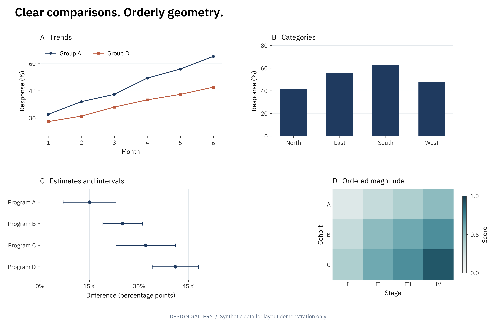

# Publication Chart Designer

**直观、规整、优美的扁平化科研图表。**



*以上为合成演示数据，仅展示布局，不代表研究结论。*

统一字体与留白、对齐的标题、等距柱形、简洁区间和规整热图，让比较一眼可读。
白底、实色、细轴线；颜色服务于数据含义。论文、屏幕、幻灯片和海报分别设置字号。

```python
use_publication_style(context="paper", language="zh")
```

`language="zh"` 自动查找已安装的中文字体；找不到时会提示安装。
`context` 支持 `paper`、`screen`、`slide`、`poster`。导出默认保持指定画布尺寸。

Rebuild the preview with `python scripts/render_gallery.py`.
Layout guidance: [Flat composition](references/flat-layout.md).
Design reference: [academic-plot](https://github.com/mintandkiwi/academic-plot),
particularly reusable profiles, Chinese support, and vector/raster export.

A Codex skill for creating, revising, and auditing accurate, accessible charts for academic papers, theses, and research reports.

The skill turns a research claim into a defensible visual encoding, then carries it through code, final-size typography, uncertainty, captions, alt text, and export review.

It includes:

- a figure contract and data/inference audit;
- chart-selection guidance;
- an evidence-based chart playbook with text budgets and optimized defaults for
  categorical, distribution, trend, forest, scatter, composition, geographic,
  paired, ranking, repeated-measures, event-study, heatmap, diagnostics, and
  small-multiple figures;
- a source list covering graphical perception, visual communication, scientific
  figure design, estimation graphics, distributions, and scientific color maps;
- a Matplotlib publication style and reusable figure helpers;
- bundled IBM Plex Sans and IBM Plex Serif fonts under the SIL Open Font License;
- refined Editorial, Ocean, Grayscale, and accessible Okabe-Ito categorical palettes;
- sequential and diverging continuous color maps;
- common journal and manuscript width profiles;
- practical recipes for interval, forest, distribution, trend, association, and small-multiple plots;
- a detailed visual and statistical review checklist;
- automated PDF/SVG/PNG export and palette-separation audits;
- caption and alt-text conventions.

The bundled IBM Plex fonts are distributed under the SIL Open Font License 1.1; see `assets/fonts/OFL.txt`.

## Install

Clone the repository into your Codex skills directory:

```bash
git clone https://github.com/ziruiKong/publication-chart-designer.git \
  "${CODEX_HOME:-$HOME/.codex}/skills/publication-chart-designer"
```

Then invoke:

```text
Use $publication-chart-designer to create a publication-ready chart from this dataset.
```

## Example

Copy `scripts/figure_kit.py` and the complete `assets/` directory into the analysis project:

```python
from figure_kit import publication_figure, refine_axes, save_publication_figure, use_publication_style

use_publication_style(
    "assets/publication.mplstyle",
    palette="editorial",
    typography="sans",
)
fig, ax = publication_figure(width="single", ratio=0.64)
# Plot the audited data here.
refine_axes(ax, grid="y")
save_publication_figure(fig, "figures/figure_02_policy_effects")
```

Audit the exported files:

```bash
python scripts/audit_figure.py figures/figure_02_policy_effects.pdf \
  figures/figure_02_policy_effects.png
python scripts/palette_audit.py --palette all
```
