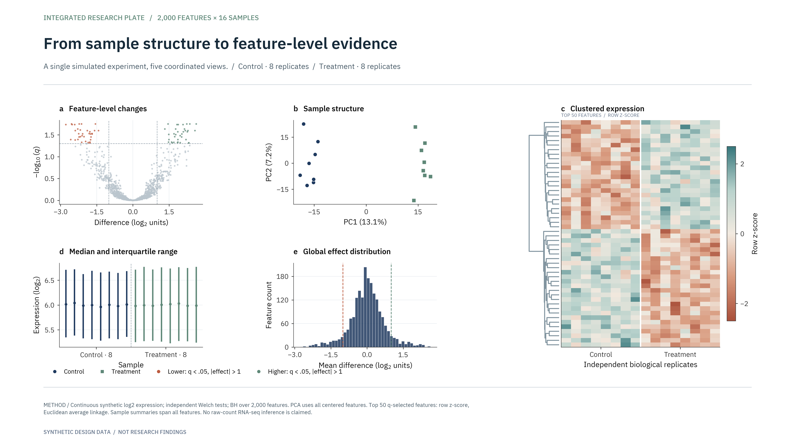
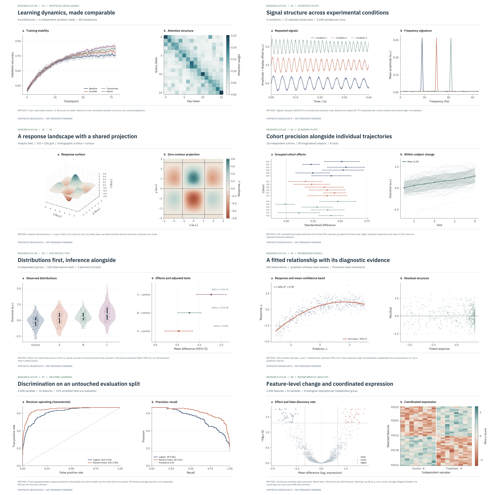

# Publication Chart Designer

**有辨识度的科研图版：丰富信息，精密排版，鲜明秩序。**



*以上为合成演示数据，仅展示布局，不代表研究结论。*

目标是让复杂数据呈现经过精密编排的高级秩序感。通过模块化图版、主次面板比例、
统一信息栏、分组间距与明确的字体角色形成辨识度，保留扁平化渲染。
标题半粗正体、轴标签与图例常规正体、数学变量局部斜体、单位与算子正体；期刊规范优先。

## Eight scientific domains



主页首图将同一实验的火山图、PCA、样本摘要、效应分布、聚类树与表达热图编排为一张综合图版。
各视图共享数据来源，图形层、分组、标题、图例和方法说明按统一网格组织。

| 领域 | 本仓库可运行示例 | 数据复杂度 |
| --- | --- | --- |
| [Artificial intelligence](docs/gallery/domains/artificial-intelligence.png) | 多模型学习曲线、种子变异与注意力矩阵 | 4 模型 × 6 种子 × 80 检查点；16 × 16 矩阵 |
| [Scientific plots](docs/gallery/domains/scientific-plots.png) | 重复信号、频谱 | 3 条件 × 12 重复 × 2,048 采样点 |
| [3D](docs/gallery/domains/3d.png) | 正交曲面、线框与等值投影 | 100 × 100 场；统一色标 |
| [Academic plots](docs/gallery/domains/academic-plots.png) | 分组区间、个体轨迹 | 18 队列；80 对象 × 8 次访问 |
| [Statistical test](docs/gallery/domains/statistical-test.png) | 分布、效应区间、Holm 校正检验 | 4 组 × 100 观测；3 个预定对比 |
| [Regression models](docs/gallery/domains/regression-models.png) | 二次 OLS、均值置信带与残差 | 600 观测；实际拟合与诊断 |
| [Machine learning](docs/gallery/domains/machine-learning.png) | 同一留出集 ROC / PR 模型比较 | 2,400 样本 × 16 特征 |
| [Bioinformatic analysis](docs/gallery/domains/bioinformatics.png) | 火山图、聚类表达热图 | 2,000 特征 × 16 样本；BH 校正 |

这些是实际计算的合成数据示例。完整选图与分析前提见 [Scientific atlas](references/domain-atlas.md)，
涵盖更多类型（PCA/UMAP、MA、富集、基因组轨道、生存、校准等）的选型指导；
这些扩展类型尚未逐一附带可运行模板，不能把选型指导当作完整分析流水线。

```bash
python -m pip install -r scripts/requirements-gallery.txt
python scripts/render_domain_gallery.py
```

每一类导出 PNG / PDF / SVG，并生成 `analysis-summary.json` 保存计算摘要与随机种子。
此外导出 `integrated-research-plate` 综合图版，示范复杂数据的整体编排。
总览图用于浏览，点击单类图片查看可读字号的完整图版。
字体规范见 [Scientific typography](references/typography.md)。

```python
use_publication_style(context="paper", language="zh")
```

`language="zh"` 自动查找已安装的中文字体；找不到时会提示安装。
`context` 支持 `paper`、`screen`、`slide`、`poster`。导出默认保持指定画布尺寸。

The basic four-chart preview remains reproducible with `python scripts/render_gallery.py`.
Layout guidance: [Flat composition](references/flat-layout.md).
Design reference: [academic-plot](https://github.com/mintandkiwi/academic-plot),
particularly reusable profiles, Chinese support, and vector/raster export.
Scope reference: [MindPlot](https://mindplot.ai/). Composition discovery:
[Plottie](https://plottie.art/). Their figures/data are not redistributed here;
the included designs and synthetic analyses are independently implemented.

A Codex skill for creating, revising, and auditing accurate, accessible charts for academic papers, theses, and research reports.

The skill turns a research claim into a defensible visual encoding, then carries it through code, final-size typography, uncertainty, captions, alt text, and export review.

It includes:

- a figure contract and data/inference audit;
- chart-selection guidance;
- an evidence-based chart playbook with text budgets and optimized defaults for
  categorical, distribution, trend, forest, scatter, composition, geographic,
  paired, ranking, repeated-measures, event-study, heatmap, diagnostics, and
  small-multiple figures;
- a source list covering graphical perception, visual communication, scientific
  figure design, estimation graphics, distributions, and scientific color maps;
- a Matplotlib publication style and reusable figure helpers;
- bundled IBM Plex Sans and IBM Plex Serif fonts under the SIL Open Font License;
- refined Editorial, Ocean, Grayscale, and accessible Okabe-Ito categorical palettes;
- sequential and diverging continuous color maps;
- common journal and manuscript width profiles;
- practical recipes for interval, forest, distribution, trend, association, and small-multiple plots;
- a detailed visual and statistical review checklist;
- automated PDF/SVG/PNG export and palette-separation audits;
- caption and alt-text conventions.

The bundled IBM Plex fonts are distributed under the SIL Open Font License 1.1; see `assets/fonts/OFL.txt`.

## Install

Clone the repository into your Codex skills directory:

```bash
git clone https://github.com/ziruiKong/publication-chart-designer.git \
  "${CODEX_HOME:-$HOME/.codex}/skills/publication-chart-designer"
```

Then invoke:

```text
Use $publication-chart-designer to create a publication-ready chart from this dataset.
```

## Example

Copy `scripts/figure_kit.py` and the complete `assets/` directory into the analysis project:

```python
from figure_kit import publication_figure, refine_axes, save_publication_figure, use_publication_style

use_publication_style(
    "assets/publication.mplstyle",
    palette="editorial",
    typography="sans",
)
fig, ax = publication_figure(width="single", ratio=0.64)
# Plot the audited data here.
refine_axes(ax, grid="y")
save_publication_figure(fig, "figures/figure_02_policy_effects")
```

Audit the exported files:

```bash
python scripts/audit_figure.py figures/figure_02_policy_effects.pdf \
  figures/figure_02_policy_effects.png
python scripts/palette_audit.py --palette all
```
